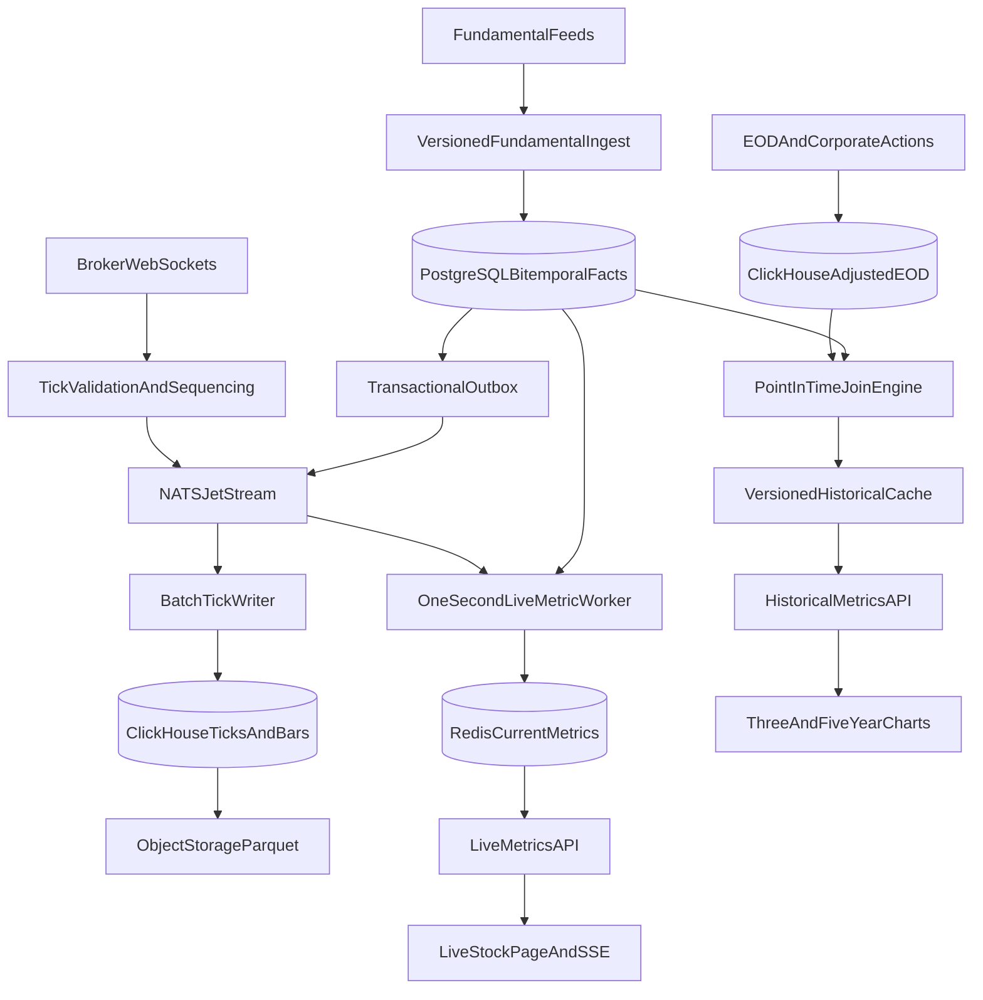

# Multi-Frequency Financial Data Platform

## Workload and design goals

The platform covers more than 5,000 NSE/BSE symbols. At one tick every 300 ms
per symbol, peak ingestion is roughly 17,000 events/second before bursts. This
is material but not “hyperscale”: it needs batching, backpressure, replay, and
columnar storage, not an automatically complex Spark/Kubernetes estate. Live
pages tolerate second-level propagation but must answer current metrics within
200 ms. Historical requests return about 750 daily points for three years and,
more importantly, must reproduce what the market could have known at each
point. Correct event time and versioning outrank microsecond latency.

## Q1: storage and point-in-time correctness

Use four components, each for a distinct access pattern.

**NATS JetStream** is the ingestion buffer for ticks, EOD arrivals, and
fundamental-change events. Approximately 17,000 events/second is comfortably
within its operating range, while durable consumers, bounded retention, and
replay isolate WebSocket reconnects from storage outages. Kafka would also
work, but its partition and broker operations are unnecessary at this initial
scale. If throughput, consumer count, or long replay windows grow by an order
of magnitude, Kafka/Redpanda can replace this boundary without changing event
schemas.

**ClickHouse** stores hot raw ticks, OHLCV bars, EOD prices, and derived daily
series. These workloads are append-heavy, time-ranged, compressed, and
analytical. ClickHouse partitions by month, orders rows by
`(instrument_id, event_time)`, and scans a few columns efficiently. PostgreSQL
alone would be simpler initially, but years of ticks would create expensive
indexes, vacuum pressure, and poor compression. ClickHouse is not the source of
truth for mutable reference data.

**PostgreSQL** stores instruments, source mappings, corporate actions, ingestion
runs, and canonical versioned fundamentals. Transactions and exclusion/unique
constraints matter more here than scan throughput. A fundamental fact contains:

```text
instrument_id, metric, fiscal_period_end, period_type,
value, currency, announcement_at, source_available_at,
ingested_at, source_version, supersedes_id,
system_valid_from, system_valid_to
```

`fiscal_period_end` is the economic period. `announcement_at` is when the issuer
published it. `source_available_at` is when the chosen feed made it accessible;
this is the market-knowledge boundary used by backtests. `ingested_at` records
platform delay. The system-valid interval records when this database believed
that source version, enabling audit queries after corrections.

Consider Q3 results released Tuesday at 19:00 and ingested at 19:03. A backtest
at Tuesday 18:59 cannot see them. A “market-known” query uses
`source_available_at <= T`; a stricter “what did our system know” replay also
requires `system_valid_from <= replay_time < system_valid_to`. If the vendor
corrects EPS on Friday, insert a new row referencing `supersedes_id` and close
the old system-valid interval. Never update the old value in place. The Friday
correction only affects market-time calculations from Friday’s availability
onward, while the original remains reproducible.

P/E requires trailing-twelve-month EPS, not simply the latest quarter. A
fundamental worker builds immutable EPS-TTM intervals whenever one of the four
contributing quarters becomes available or is restated:

```text
instrument_id, metric=EPS_TTM, value,
market_valid_from, market_valid_to,
system_valid_from, system_valid_to, component_version_ids
```

The historical join selects the EPS-TTM interval where
`market_valid_from <= price_time < market_valid_to`, plus the optional
system-time predicate. This prevents today’s EPS from leaking into a 2022 P/E.

**S3-compatible object storage with Parquet** is bounded cold storage. Raw ticks
remain in ClickHouse for 30 days, one-second bars for 90 days, one-minute OHLCV
for five years, and daily OHLCV indefinitely. Raw ticks move to date/exchange/
instrument-bucketed Parquet and expire after one year unless a documented
regulatory or research policy extends retention. Fundamentals, lineage, EOD
prices, and corporate actions remain indefinitely because they are small and
essential for reproducibility. This avoids the naive and costly promise to keep
every raw tick forever.

## Q2: derived-metric compute

Use a hybrid policy rather than exclusively compute-on-write or compute-on-read.
A tick ingestion service validates schema, assigns source/event/receive
timestamps and a sequence, publishes to JetStream, and batches raw writes to
ClickHouse. A live worker keeps the latest price per instrument, coalesces
bursts to one update per second, reads the current EPS-TTM snapshot, computes
P/E and other inexpensive metrics, and writes a versioned current snapshot to
Redis. Coalescing meets the UI requirement while preventing 17,000 ticks/second
from becoming 17,000 cache writes and client messages.

When a new fundamental arrives, a transaction stores its immutable version and
lineage. After commit, an outbox publisher emits a change event. The worker
rebuilds affected TTM intervals, recomputes current metrics only for affected
instruments, increments their data version, and invalidates corresponding
historical cache keys. The transactional outbox prevents a committed fact from
being silently missed if event publication fails.

Daily historical P/E is calculated on demand in ClickHouse from adjusted EOD
prices and replicated EPS-TTM intervals using an as-of range join. Frequently
requested symbol/range combinations are cached, and common five-year daily
series may be materialized after EOD or a fundamental correction. Computing
every historical range on every tick wastes work; precomputing every possible
range wastes storage and complicates corrections. The hybrid limits write
amplification while keeping interactive requests predictable.

Workers are idempotent on `(source, event_id)` and maintain source sequence
watermarks. Late ticks are written with both event and ingestion time and can
repair bars inside a controlled lateness window. Beyond that window they create
an auditable correction job. Dead-letter subjects retain malformed events;
lag, reconnect count, duplicate count, late-event age, and derived-data version
are observable metrics.

## Q3: APIs and low-latency serving

The live endpoint is `GET /v1/instruments/{id}/metrics/current`. It reads a
single Redis object containing price timestamp, fundamental version, P/E,
momentum, yield, and data freshness. A small PostgreSQL/Redis instrument lookup
resolves symbols. Redis is justified because current snapshots are repeatedly
read, tiny, and replaceable; it is not a source of truth. A five-to-ten-second
TTL bounds stale data, while explicit versioned writes provide normal
invalidation. On a cache miss, the API reconstructs one instrument from latest
ClickHouse price and PostgreSQL fundamental data, then repopulates Redis. This
keeps the normal path under 200 ms. WebSocket or SSE publishes at most one
versioned update per second per subscribed symbol; slow clients receive the
latest snapshot rather than an unbounded queue.

The historical endpoint is
`GET /v1/instruments/{id}/metrics/pe?from=&to=&frequency=1d`. It is separate
because its workload and cache lifetime differ. The service validates a bounded
range, executes the point-in-time join, and returns column-oriented arrays of
timestamps, price, EPS-TTM, P/E, and data-version metadata. About 750 points do
not require pagination, though larger intraday ranges do. Cache keys include
instrument, adjusted-price version, fundamental-version watermark, date range,
and frequency. New EOD data or a restatement changes the version rather than
requiring fragile wildcard deletion. Responses expose `as_of`, source
freshness, and whether adjusted or unadjusted prices were used.

Redis failure degrades live reads to the databases with rate protection;
ClickHouse failure can serve a stale, explicitly labelled cached series;
PostgreSQL fundamental writes stop rather than produce unversioned metrics.
Circuit breakers and bounded retries apply only to idempotent reads/writes.

## Q4: full architecture



Start with one deployment per component and managed PostgreSQL/object storage.
Scale TickWriter and LiveWorker by stable instrument partitions only when lag
demonstrates need. Kubernetes, Spark, Flink, and a broad microservice split add
failure modes without solving the current second-level, 5,000-symbol workload.
The durable stream, immutable schemas, and storage boundaries preserve a clear
upgrade path if measured load later justifies them.
