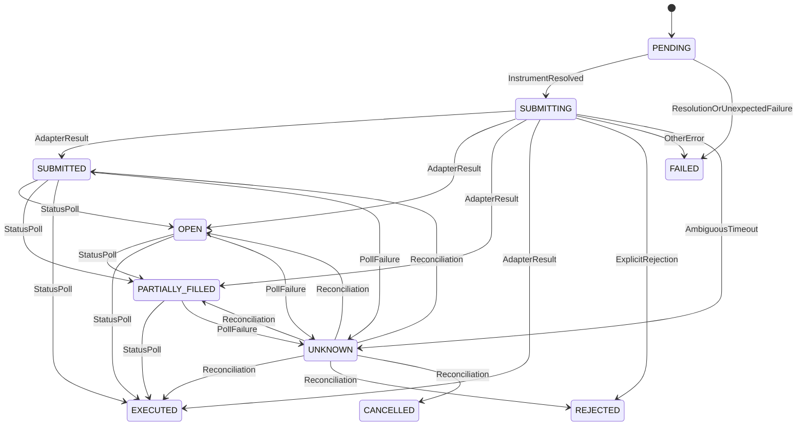

# Problem 1 Core Code Audit

Reviewed: 2 October 2026

Scope:

- `app/domain.py`
- `app/brokers.py`
- `app/mock_broker.py`
- `app/services.py`
- `app/persistence.py`
- `app/main.py`
- `app/notifications.py`
- `app/config.py`
- `tests/test_execution_engine.py`
- `tests/test_api.py`
- `migrations/env.py`
- `migrations/versions/0001_initial.py`

This is a code-level review of the core execution path. It does not rely on
README or checklist claims, and it does not yet review the five real broker
adapters.

## Summary

| Area | Verdict |
|---|---|
| A. First-time portfolio | IMPLEMENTED BUT HAS A RISK |
| B. Rebalance | IMPLEMENTED CORRECTLY |
| C. Order state machine | MISSING enforcement |
| D. Unknown/timeout safety | IMPLEMENTED BUT HAS A RISK |
| E. Idempotency | IMPLEMENTED BUT HAS A RISK |
| F. Transaction boundaries | IMPLEMENTED BUT HAS A RISK |
| G. Retries | IMPLEMENTED BUT HAS A RISK |
| H. Partial failure | IMPLEMENTED CORRECTLY, with policy risk |
| I. Notifications | IMPLEMENTED BUT HAS A RISK |
| J. API layer | IMPLEMENTED BUT HAS A RISK |
| K. Security | MISSING user authorization; other controls partial |
| L. Tests | IMPLEMENTED BUT HAS GAPS |

## A. First-time portfolio

**Status: IMPLEMENTED BUT HAS A RISK**

Actual path:

```text
POST /api/v1/executions
→ ExecutionRequest validation
→ ExecutionService.execute()
→ adapter.get_holdings()
→ reject if any quantity > 0
→ convert every portfolio item into BUY
→ persist execution and orders
→ resolve each instrument
→ submit each order sequentially
→ optionally poll status
→ aggregate execution status
→ persist result
→ notify
→ persist notification status
```

Findings:

- **IMPLEMENTED CORRECTLY:** `FIRST_TIME` requires a non-empty `portfolio` and
  forbids `orders`.
- **IMPLEMENTED CORRECTLY:** any returned holding with quantity greater than
  zero prevents execution.
- **IMPLEMENTED CORRECTLY:** every portfolio item becomes one BUY with the same
  symbol, exchange, ISIN, and quantity.
- **IMPLEMENTED CORRECTLY:** quantities are constrained to `1..1,000,000`.
- **IMPLEMENTED CORRECTLY:** symbols have a restrictive syntax.
- **IMPLEMENTED CORRECTLY:** per-order failures are caught, processing
  continues, and the aggregate can become `PARTIAL_SUCCESS`.
- **IMPLEMENTED BUT HAS A RISK:** semantic instrument safety is delegated to
  each adapter. The core does not verify that `ResolvedInstrument` still
  matches the requested symbol, exchange, or ISIN.
- **UNCLEAR / NEEDS VERIFICATION:** whether each real adapter includes
  T1/unsettled and all other relevant holdings.
- **MISSING:** a dedicated first-time partial-failure test.

Important idempotency defect: holdings retrieval occurs before idempotency
lookup. Repeating a successful first-time request with the same key may find
new holdings and return a conflict instead of the original execution.

## B. Rebalance

**Status: IMPLEMENTED CORRECTLY**

For `REBALANCE`, the service returns the supplied instructions unchanged. It
does not calculate a portfolio delta.

For:

```text
SELL RELIANCE 5
BUY INFY 10
SELL TCS 2
```

the persisted sequence is:

```text
0: RELIANCE, SELL, 5
1: INFY, BUY, 10
2: TCS, SELL, 2
```

Findings:

- **IMPLEMENTED CORRECTLY:** no automatic delta is calculated.
- **IMPLEMENTED CORRECTLY:** sides and quantities are copied exactly.
- **IMPLEMENTED CORRECTLY:** input order is preserved through the persisted
  `sequence`.
- **IMPLEMENTED CORRECTLY:** execution is sequential.
- **IMPLEMENTED BUT HAS A RISK:** signed adjustments such as `+5/-2` are not a
  separate input form; callers must normalize them into BUY/SELL instructions.
- **IMPLEMENTED BUT HAS A RISK:** duplicate instructions for one symbol are
  accepted without an explicit policy.

## C. Order state machine

**Status: MISSING enforcement**

Defined order states:

```text
PENDING
SUBMITTING
SUBMITTED
OPEN
PARTIALLY_FILLED
EXECUTED
REJECTED
FAILED
CANCELLED
UNKNOWN
```

`RECONCILIATION_REQUIRED` is an execution state, not an order state.

Actual conventional transitions:



These transitions are not enforced:

- **MISSING:** transition validation.
- **MISSING:** rejection of regressions such as `EXECUTED → OPEN`.
- **MISSING:** database CHECK constraints for valid statuses.
- **MISSING:** `0 <= filled_quantity <= quantity` enforcement.
- **MISSING:** execution-state transition validation.
- **IMPLEMENTED BUT UNUSED:** `TERMINAL_ORDER_STATUSES`.
- **IMPLEMENTED BUT HAS A RISK:** an adapter can return any `OrderStatus`, and
  the repository writes it without validating the current state.

The implementation has status assignments, not an enforced state machine.

## D. Unknown and timeout safety

**Status: IMPLEMENTED BUT HAS A RISK**

### Timeout without broker order ID

For a non-retryable request, an HTTP timeout becomes
`OrderStatusUnknownError`. The service stores `UNKNOWN`, and aggregate
execution status becomes `RECONCILIATION_REQUIRED`.

- **IMPLEMENTED CORRECTLY:** submission timeout is not retried.
- **IMPLEMENTED CORRECTLY:** the order becomes `UNKNOWN`.
- **IMPLEMENTED CORRECTLY:** the execution becomes
  `RECONCILIATION_REQUIRED`.
- **IMPLEMENTED CORRECTLY:** later reconciliation only calls
  `get_order_status()`; it does not submit a replacement order.
- **UNCLEAR / NEEDS VERIFICATION:** recovery without a broker order ID depends
  on each adapter supporting lookup by client correlation ID.
- **MISSING TEST:** UNKNOWN successfully reconciling to EXECUTED.
- **MISSING TEST:** the reconciliation API.

### Broker ID returned, status lookup fails

This path is implemented more safely. The service stores `UNKNOWN` while
retaining the broker order ID. A test covers this case.

### Critical gaps

1. `SUBMITTING` is not included in reconciliation.
2. A crash after broker acceptance but before DB acknowledgement leaves
   `SUBMITTING` permanently.
3. Non-timeout transport failures become `FAILED`, even though some can happen
   after submission.
4. An HTTP 5xx after broker acceptance becomes `FAILED`, not `UNKNOWN`.
5. A malformed successful placement response becomes `FAILED`, although the
   broker may have accepted the order.
6. If the broker accepts and the DB acknowledgement update fails, the generic
   exception handler can subsequently mark the order `FAILED`.

These cases weaken the financial meaning of `FAILED`.

## E. Idempotency

**Status: IMPLEMENTED BUT HAS A RISK**

Sequential behavior:

1. First key K creates the execution and orders.
2. Same key and same request hash returns the existing execution.
3. Same key and different hash raises `IdempotencyConflictError`.
4. The API maps that domain error to HTTP 409.
5. The database has a unique index on `idempotency_key`.

### Concurrent behavior

The implementation performs:

```text
SELECT by key
if absent:
    INSERT
```

Two concurrent transactions can both observe no row. The unique index prevents
two committed executions, but the losing transaction receives an unhandled
integrity error rather than loading the winner.

- **IMPLEMENTED CORRECTLY:** the database prevents two committed execution
  rows with one key.
- **IMPLEMENTED BUT HAS A RISK:** concurrent identical requests can produce an
  HTTP 500.
- **MISSING:** catch-constraint-conflict-and-reload behavior.
- **MISSING TEST:** concurrent same-key requests.

### Request hash

The hash uses:

```text
SHA256(request.model_dump_json(exclude={"confirm_live"}))
```

Risks:

- Serialization is stable for the current model but not explicitly
  canonicalized with sorted keys.
- Decimal representations may differ for semantically equivalent inputs.
- `confirm_live` is omitted.
- Live-trading and first-time holdings checks happen before idempotency lookup.
- Therefore an existing execution may not be returned if a mutable
  precondition now fails.

## F. Database transaction boundaries

**Status: IMPLEMENTED BUT HAS A RISK**

Every mutation uses a short `session_factory.begin()` transaction:

- execution and initial-order creation;
- execution status update;
- each order update;
- notification status update.

Broker network calls happen after repository transaction blocks have exited.
The application does not intentionally hold a transaction open while waiting
on a broker.

### Failure windows

#### Execution committed, crash before submission

State:

```text
execution: PENDING or RUNNING
orders: PENDING
```

There is no startup recovery. Manual reconciliation ignores `PENDING`.

#### SUBMITTING committed, crash before broker request

State:

```text
order: SUBMITTING
```

The system cannot establish whether submission occurred, and reconciliation
ignores the order.

#### Broker accepts, crash before DB update

State:

```text
database: SUBMITTING
broker: order exists
```

The current reconciliation implementation cannot recover it.

#### Broker accepts, DB update fails

The update exception is caught by the generic handler, which attempts another
update setting `FAILED`.

If that second update succeeds:

```text
database: FAILED
broker: accepted/open/executed
```

If it fails:

```text
database: SUBMITTING
broker: accepted/open/executed
```

The first outcome is a dangerous false terminal result; the second is not
recoverable through the current reconciliation path.

## G. Retries

**Status: IMPLEMENTED BUT HAS A RISK**

When `safe_to_retry=True`:

- maximum attempts: 3;
- delays: 50 ms, then 100 ms;
- timeout: retried;
- transport error: retried;
- 429: retried;
- 5xx: retried;
- authentication errors: not retried;
- other 4xx: not retried.

Order submission uses `safe_to_retry=False`:

- one attempt;
- no retry for timeout, 429, 5xx, transport error, or malformed response.

This prevents the shared helper from automatically duplicating order
submissions.

Risks:

- **MISSING:** jitter.
- **MISSING:** `Retry-After` handling.
- **MISSING:** per-account/broker throttling.
- **IMPLEMENTED BUT HAS A RISK:** safety depends on adapter authors selecting
  the boolean correctly. The helper does not reject retryable POST requests.
- **IMPLEMENTED BUT HAS A RISK:** 50/100 ms delays are too aggressive for many
  real 429 responses.
- **IMPLEMENTED BUT HAS A RISK:** 5xx and some transport failures can be
  ambiguous but become unavailable/failed.
- **MISSING:** retry attempt logging and metrics.

## H. Partial failure

**Status: IMPLEMENTED CORRECTLY, with policy risk**

For:

```text
Order 1: EXECUTED
Order 2: REJECTED
Order 3: EXECUTED
```

the exact execution result is `PARTIAL_SUCCESS`.

For:

```text
Order 1: EXECUTED
Order 2: UNKNOWN
Order 3: pending in sequence
```

the engine continues and submits Order 3. The final execution becomes
`RECONCILIATION_REQUIRED` because UNKNOWN dominates aggregation.

Continuing after UNKNOWN is a safety-policy risk. An unknown sell followed by a
buy can compound exposure or funding uncertainty. The assignment does not
dictate stop-versus-continue behavior, but the policy should be explicit.

## I. Notifications

**Status: IMPLEMENTED BUT HAS A RISK**

Notification occurs after order processing and after execution status is
persisted.

The console payload contains:

- execution ID;
- execution status;
- broker;
- every order;
- side and requested quantity;
- filled quantity;
- order status;
- error.

The webhook receives the full `ExecutionView`.

Findings:

- **IMPLEMENTED CORRECTLY:** notification occurs after execution processing.
- **IMPLEMENTED CORRECTLY:** successful and failed orders are included.
- **IMPLEMENTED CORRECTLY:** notification failure changes only
  `notification_status`.
- **IMPLEMENTED CORRECTLY:** webhook failure does not retry a trade.
- **IMPLEMENTED CORRECTLY:** `ExecutionView` has no credential/token fields.
- **IMPLEMENTED BUT HAS A RISK:** arbitrary broker error text can enter logs
  and webhook payloads.
- **IMPLEMENTED BUT HAS A RISK:** every reconciliation calls `_finalize()` and
  may send a duplicate notification even if no state changed.
- **MISSING:** notification idempotency.
- **MISSING TEST:** actual console notification contents.
- **MISSING TEST:** webhook contents and failure behavior.
- **MISSING:** closing the internally created webhook HTTP client.
- **UNUSED:** `MockBrokerState.notification_fail`.

## J. API layer

**Status: IMPLEMENTED BUT HAS A RISK**

Execution handlers are thin; execution behavior lives in `ExecutionService`.

Correct behavior:

- Pydantic validates execution input.
- Execution POST and GET routes use `ExecutionView`.
- Reconciliation uses `ExecutionView`.
- Idempotency conflict maps to 409.
- Existing holdings maps to 409.
- Missing execution maps to 404.
- Disabled live execution maps to 403.
- request validation maps to 422.

Risks and gaps:

- Every `TradeEngineError` maps to 502, including authentication, throttling,
  instrument resolution, rejection, and delivery authorization.
- The orders-list endpoint has no response model and is untyped.
- An idempotent replay still returns 201.
- Concurrent idempotency constraint errors are unhandled.
- Database errors are unhandled.
- `/ready` always returns ready without checking the database.
- OAuth state is held in memory, one value per broker, with no TTL.
- Concurrent authentication starts for one broker overwrite each other.
- No user authentication or authorization protects execution routes.
- Reconciliation errors are swallowed without updating an error reason.
- Composition, auth orchestration, exceptions, and routes all reside in
  `main.py`.

## K. Security

**Status: MISSING authorization; other controls partial**

Implemented correctly:

- no hardcoded production credential values in reviewed source;
- environment settings use `SecretStr`;
- credentials are held in adapter memory, not execution/order tables;
- authorization headers are not explicitly logged;
- no permissive CORS middleware;
- debug mode is not enabled;
- broker selection is constrained by `BrokerName`;
- SQLAlchemy ORM avoids string-built SQL;
- symbol, quantity, exchange, product, order type, and validity are validated.

Risks:

- **MISSING:** API authentication.
- **MISSING:** authorization protecting real-money execution.
- `confirm_live=true` is a request flag, not an authorization control.
- `BrokerCredentials` is a normal dataclass whose repr exposes access tokens
  and API secrets if logged.
- Generic exceptions are persisted and forwarded to notifications.
- Broker 4xx response bodies up to 500 characters are stored and can be logged.
- Credentials and adapters are singleton state, not user-scoped.
- OAuth state is not multi-user or multi-replica safe.
- No DB constraints enforce positive quantity, valid status, or valid side.
- Runtime `create_schema()` runs even though Alembic migrations exist.
- Health/readiness does not verify dependencies.

## L. Test quality

**Status: IMPLEMENTED BUT HAS GAPS**

| Requirement | Test file | Test name | What it actually proves | Gap |
|---|---|---|---|---|
| First-time buys all items | `test_execution_engine.py` | `test_first_time_portfolio_buys_all_items` | Two items become BUYs with matching fills | No API path or first-time partial failure |
| Existing holdings reject first-time | `test_execution_engine.py` | `test_first_time_rejects_nonempty_account` | Positive mock holding raises domain error | Does not prove real holdings completeness or API 409 |
| Mixed explicit rebalance | `test_execution_engine.py` | `test_mixed_rebalance_preserves_instruction_order` | Exact symbol/side/quantity order survives | Does not inspect raw DB independently |
| Partial execution | `test_execution_engine.py` | `test_partial_failure_keeps_successful_trades` | Success/reject/success becomes partial success | No partial-fill case |
| Ambiguous submission | `test_execution_engine.py` | `test_ambiguous_submission_is_unknown_and_not_retried` | Timeout becomes UNKNOWN and reconciliation-required | Mock never records acceptance; no recovery |
| Status lookup failure | `test_execution_engine.py` | `test_acknowledged_order_with_failed_status_lookup_requires_reconciliation` | Broker ID retained with UNKNOWN | No successful later reconciliation |
| Sequential idempotent replay | `test_execution_engine.py` | `test_idempotent_replay_returns_existing_execution` | Same ID returned, notifier not called twice | No concurrency or first-time replay |
| Idempotency conflict | `test_execution_engine.py` | `test_idempotency_key_payload_conflict` | Domain conflict raised | API 409 not tested |
| Notification failure | `test_execution_engine.py` | `test_notification_failure_does_not_change_trade_success` | Trade remains successful | Uses custom notifier, not webhook |
| Input validation | `test_execution_engine.py` | `test_invalid_quantity_and_symbol_are_rejected` | Zero quantity and path-like symbol rejected | Limited boundary coverage |
| Limit order validation | `test_execution_engine.py` | `test_limit_order_requires_price` | LIMIT requires price | MARKET-with-price untested |
| Registry extension | `test_execution_engine.py` | `test_adapter_registry_extension_does_not_change_execution_engine` | Registry returns mock adapter | Does not execute a sixth adapter |
| API execution/replay/OpenAPI | `test_api.py` | `test_mock_execution_and_idempotent_readback` | POST, replay, GET, and OpenAPI function | No conflict/concurrency semantics |
| API partial failure | `test_api.py` | `test_api_partial_failure` | Two-order API request gives partial success | Detailed error contract not checked |
| API validation | `test_api.py` | `test_api_requires_idempotency_header_and_valid_quantity` | Missing key and bad quantity return 422 | Exception handlers otherwise untested |
| Reconciliation | None | None | Nothing | Critical missing test |
| Concurrent idempotency | None | None | Nothing | Critical missing test |
| Transition enforcement | None | None | Nothing | No enforcement exists |
| Crash/restart recovery | None | None | Nothing | Critical missing behavior |
| PostgreSQL behavior | None in reviewed tests | None | Tests use SQLite | Unique-race behavior unproved |
| Webhook | None | None | Nothing | Actual webhook untested |
| Retry/backoff | None in reviewed tests | None | Nothing | Shared retry helper unproved here |
| Ready/DB health | None | None | Nothing | Endpoint always reports ready |
| Authorization | None | None | Nothing | Authorization is absent |

## M. Critical review

### Top 10 risks by severity

1. Broker accepts an order, DB acknowledgement fails, and the order can be
   recorded `FAILED`.
2. A crash leaves `SUBMITTING` orders unrecoverable.
3. No API authentication or authorization protects live execution.
4. Ambiguous 5xx, malformed responses, and non-timeout transport errors become
   `FAILED` rather than `UNKNOWN`.
5. State transitions are not enforced.
6. Concurrent idempotency races cause unhandled integrity errors.
7. First-time holdings validation occurs before idempotency lookup.
8. Execution continues after UNKNOWN and may compound exposure.
9. No startup recovery exists for interrupted executions.
10. Generic/broker exception text can enter DB records, logs, and webhooks.

### Bugs to fix before submission

1. Never mark a broker-acknowledged order FAILED because persistence failed.
2. Reconcile `SUBMITTING`.
3. Add startup/manual recovery for interrupted executions.
4. Treat potentially post-submit transport/5xx/malformed responses as UNKNOWN.
5. Convert concurrent idempotency conflicts into winner-row reloads.
6. Perform idempotency lookup before mutable preconditions.
7. Enforce valid state transitions.
8. Decide whether UNKNOWN halts subsequent orders.
9. Protect live routes with authentication and authorization, or ensure real
   execution is impossible in the submitted demo.
10. Map domain failures to appropriate HTTP statuses.

### Acceptable 24-hour weaknesses

- sequential execution;
- modular monolith;
- no frontend;
- no distributed worker;
- in-memory OAuth/token state when explicitly demo-only;
- SQLite-focused unit tests plus separate Docker smoke verification;
- bounded status polling instead of broker WebSocket updates;
- console notifier as the primary assignment notification.

### Claims not fully proved by code/tests

- “State machine”: statuses exist, but transitions are not enforced.
- “Concurrent idempotency”: uniqueness prevents two committed rows, but
  graceful concurrency is not implemented.
- “Reconciliation preserves recoverable state”: `SUBMITTING` and `PENDING` are
  excluded.
- “Bounded retry only for safe reads”: safety depends on adapter authors
  selecting a boolean correctly.
- “PostgreSQL persistence is tested”: reviewed tests use SQLite.
- “Webhook notification is tested”: it is not.
- “Unknown state is recoverable”: no UNKNOWN→EXECUTED test proves it.
- “Structured logging”: execution lifecycle transitions are not structurally
  logged.
- “Failure handling prevents duplicate trades”: crash/DB-failure windows remain
  dangerous.

### Potentially embarrassing interview points

- calling the status assignments a state machine;
- claiming concurrency-safe idempotency without handling unique-race errors;
- claiming crash recovery while ignoring `SUBMITTING`;
- recording an accepted broker order as FAILED after a DB failure;
- returning 502 for unrelated failure categories;
- claiming structured audit logging without lifecycle logs;
- exposing `/ready` without checking readiness;
- carrying unused `CredentialStore`, `TERMINAL_ORDER_STATUSES`,
  `execution_json`, and `notification_fail`.

### Unnecessary complexity

- `CredentialStore` exists but credentials are mutated directly on singleton
  adapters.
- Alembic and runtime `create_all()` are both used.
- Every real adapter is created even when unconfigured.
- Composition, auth, handlers, and routes all live in `main.py`.
- `execution_json()` is unused.

### Important missing items

- enforced state transitions;
- interrupted-execution recovery;
- successful reconciliation tests;
- concurrent idempotency tests;
- PostgreSQL concurrency tests;
- API authentication and authorization;
- lifecycle/audit logging;
- per-account rate limiting and `Retry-After`;
- notification deduplication;
- database quantity/status constraints;
- explicit stop/continue policy after UNKNOWN.
