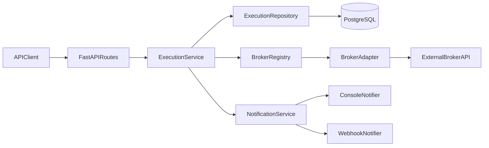
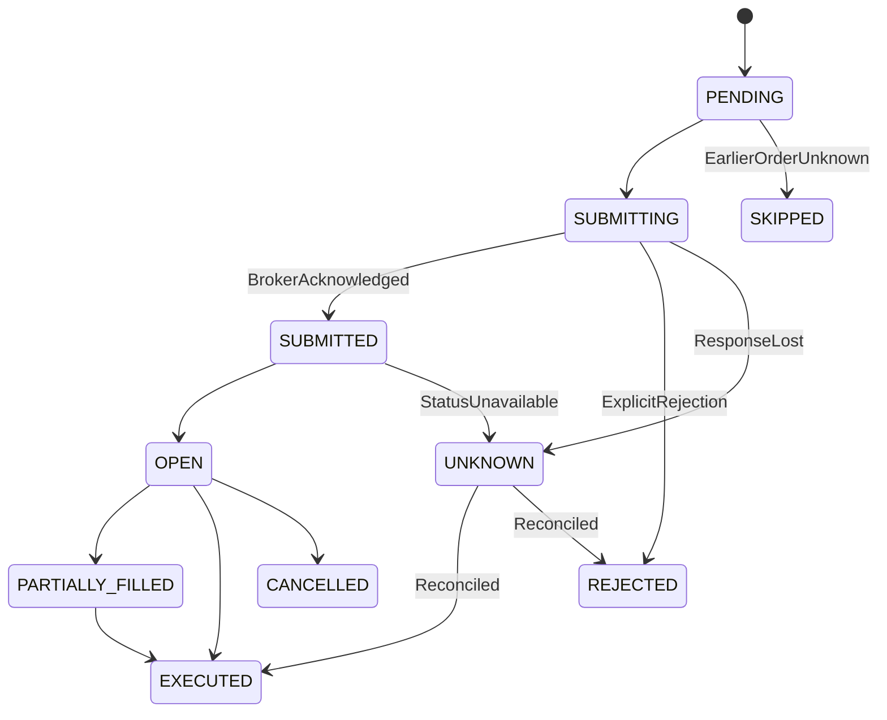

# Trade Execution Architecture

## Component model

The service is a modular monolith. FastAPI validates the public contract;
`ExecutionService` owns orchestration; SQLAlchemy repositories own durable
state; broker adapters translate external APIs into broker-neutral domain
models. Routes never construct broker payloads.

The core imports only `BrokerAdapter`, `BrokerOrderRequest`,
`BrokerOrderResult`, `Holding`, and `ResolvedInstrument`. Broker-specific
symbols, tokens, status names, authentication, and errors stop at the adapter.
Adding a broker requires one adapter class, its registry entry, configuration,
research documentation, and contract tests; the execution service does not
change.

## Workflows

`FIRST_TIME` accepts a target portfolio. The engine fetches holdings and
requires the account to be empty, then creates BUY instructions. It deliberately
rejects a non-empty account instead of calculating a delta.

`REBALANCE` accepts explicit BUY/SELL instructions and executes them in input
order. No optimizer or automatic delta calculation is hidden in this path.
Requests expose visible defaults for NSE cash delivery, market order, and DAY
validity. An adapter must still resolve exactly one current instrument; zero or
multiple matches fail before submission.

## Idempotency and transaction boundaries

`POST /api/v1/executions` requires `Idempotency-Key`. The service hashes the
Pydantic JSON payload, excluding `confirm_live`, and inserts the
execution/orders under a unique database constraint. Reusing the key with the
same hash returns the existing execution. Reusing it with a different hash
returns HTTP 409.

Database transactions are short:

1. Persist execution and intended orders, then commit.
2. Persist `SUBMITTING`, then commit.
3. Call the external broker without holding a transaction.
4. Persist acknowledgement/status/error, then commit.
5. Aggregate execution state, commit, and notify.

This cannot provide distributed exactly-once execution. It prevents duplicate
API handling locally and preserves enough correlation data to reconcile
broker-side uncertainty.

## State and ambiguous submission

The diagram shows the principal execution path. `ORDER_STATUS_TRANSITIONS` in
`app/domain.py` is the complete enforced table. It also allows explicit
authentication, rate-limit, and delivery-authorization failures to move from
`SUBMITTING` to `FAILED`. It does not allow a terminal state to regress.

A timeout during a non-idempotent place-order call is never retried. The same
ambiguity rule applies to transport failures, HTTP 5xx responses, malformed
placement responses, and failure to persist a broker acknowledgement: none
proves that the broker rejected the order. The order becomes `UNKNOWN` where a
fallback write is possible; otherwise its already-durable `SUBMITTING` state
continues to represent the uncertainty. The execution becomes
`RECONCILIATION_REQUIRED`.

The engine stops submitting the execution's remaining orders after the first
ambiguous outcome and marks them `SKIPPED`. This avoids creating further
dependent financial side effects while the account position is uncertain.

A later explicit reconciliation investigates both `UNKNOWN` and `SUBMITTING`
orders. DhanHQ, Groww, Upstox, and Zerodha expose the client correlation/tag
lookup used when no broker order ID was saved. The currently verified Angel One
status contract requires its broker order ID; an interrupted Angel One
placement without that ID therefore remains unresolved and requires manual
broker investigation. Reconciliation never resubmits an order. Safe idempotent
reads may use bounded retry; rejected orders and validation failures are not
retried.

Execution aggregation is:

- `SUCCESS`: every order executed.
- `PARTIAL_SUCCESS`: at least one executed and remaining orders reached explicit
  terminal failures.
- `FAILED`: no order executed and all outcomes are explicit failures.
- `RECONCILIATION_REQUIRED`: any order is
  submitting/submitted/open/part-filled/unknown after the bounded observation
  window.

Notification is dispatched after the execution outcome is persisted. A failed
webhook changes only `notification_status`, never a successful trade outcome.

## Security and production boundary

The repository contains no broker credentials. Environment values are wrapped
as secrets and authorization headers are never logged. OAuth-style flows use a
single-use state value. Live calls require both `ALLOW_LIVE_TRADING=true` and
`confirm_live=true`; the default Docker environment cannot place a live order.
Those controls prevent accidental execution; they are not user authentication
or authorization. The default local path uses MockBroker and no real
credentials.

This is an assignment demonstration, not production trading infrastructure.
Production requires authenticated end users, authorization policy, KMS-backed
encrypted token storage, CSRF state storage shared across replicas, broker
postbacks/WebSockets, a durable worker queue, reconciliation operations, static
egress IPs, DDPI/eDIS user experience, audit retention, and controlled broker
certification.
